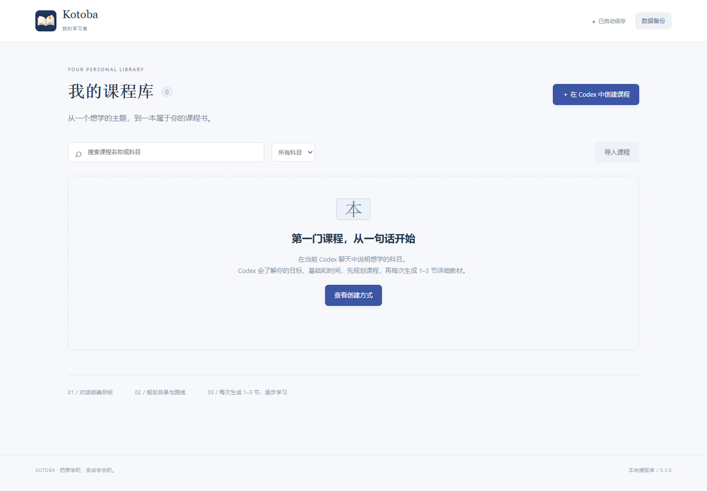
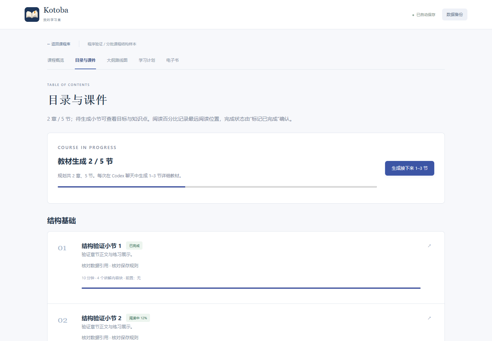

# Kotoba 学习室 · 0.3.0

本地课程库框架。在 Codex 聊天中规划完整课程，再按学习进度每次生成1–3节详细教材。课程内部包含目录、知识点思维导图、依赖路线、学习计划、课件与离线电子书。

## 启动

需要 Node.js 24+，运行时无第三方依赖，无需安装 npm 依赖或构建。

Windows 双击 `启动学习室.cmd`。运行 `创建桌面快捷方式.cmd` 可创建带图标的桌面入口；移动项目后重新创建。其他平台或终端使用：

    npm start

打开 [本地课程库](http://127.0.0.1:4173)。服务只监听本机。关闭网页时保存待写入内容；Windows 双击 `停止学习室.cmd` 可停止后台，终端启动则使用 Ctrl+C。

首次启动为空课程库，共享版本不附带课程。

## 规划与分批精讲

在 Codex 中打开此项目，说明学习主题。流程由 [AGENTS.md](AGENTS.md) 和 [课程编写规范](COURSE_AUTHORING.md) 定义：

1. 集中了解尚未明确的目标、基础、时间和偏好。
2. 先发布完整课程大纲、章与节目录、章节数、知识点思维导图、依赖路线和学习计划。此时正文为“待生成”。
3. 收到教材生成请求后，每次追加1–3节详细讲解、例子、练习解析和实践任务，完成本批后等待下一次请求。
4. 在课程内学习，按需要继续生成后续教材。

课程概览和待生成小节提供“生成接下来1–3节”提示词，可复制到当前项目的 Codex 聊天。应用负责保存与展示，模型生成使用各自的 Codex 账号，不需要在应用中填写 API 密钥。

新教材逐点对应规划中的知识点。程序检查正文、练习、实践和覆盖关系，并拒绝超过三节、缺少前置、覆盖既有教材或使用过期版本的批次。字数检查仅用于拦截明显过薄的内容，教学准确性与实际掌握仍需审阅和验证。

## 学习进度与接续

- 每节分别显示未开始、阅读中及已完成状态。
- 阅读百分比记录最远阅读位置，实际停留位置分别保存；重新进入该节自动恢复位置。
- 课程概览提供“继续上次学习”，返回最近阅读的小节。
- 阅读到页底不自动判定掌握，点击“标记已完成”确认完成。
- 笔记、当前实践草稿和阅读位置自动保存，退出时补充保存。追加教材保留所有既有学习数据。

连接暂时中断时，待保存草稿留在当前浏览器，连接恢复后继续写入；换浏览器前应确认已保存并导出备份。理解自测提供即时解析，不保存逐次答题历史。

## 目录、地图与电子书

目录按章节组织小节，区分“教材待生成”和学习状态。思维导图展示“课程 → 章节 → 小节 → 知识点”；依赖路线图表示前置关系。

电子书采用离线 HTML，包含全程规划及当前已生成的教材、练习解析和项目。未生成部分明确标为规划。下载文件为当前快照，追加教材后重新导出，可使用浏览器打印成 PDF。其他文档格式需另行制作。

课程概览底部支持两步确认删除：核对删除范围，再输入完整课程名称。删除当前库中的课程、笔记、实践草稿和进度不可在应用中撤销；已导出文件和备份会保留。

## 命令行与开发

    node scripts/course.mjs brief "学习主题"
    node scripts/course.mjs validate "data/drafts/course-plan.json"
    node scripts/course.mjs plan "data/drafts/course-plan.json"
    node scripts/course.mjs append "data/drafts/course-batch-001.json"
    node scripts/course.mjs list
    node scripts/course.mjs show <course-id>
    npm test

完整 JSON 格式、知识点覆盖和教学检查见 [COURSE_AUTHORING.md](COURSE_AUTHORING.md)。已有完整课程可继续导入阅读；兼容命令 `publish <complete-course.json>`。

| 文件 | 用途 |
| --- | --- |
| src/domain.mjs | 课程规划、详细教材、批次与学习进度规则 |
| src/publishing.mjs | 课程与电子书一致发布，失败回滚 |
| src/store.mjs | SQLite、自动保存和备份恢复 |
| src/server.mjs | 本地 HTTP 服务及导入导出 |
| src/book.mjs | 正文、知识地图与离线教材渲染 |
| scripts/course.mjs | 访谈、规划、分批追加及验证命令 |
| public/、test/ | 阅读界面、测试与合成输入 |

默认数据库位于 `data/kotoba.sqlite`。环境变量 `PORT` 可修改端口，`KOTOBA_DATA_DIR` 可分离数据库。首页导入课程 JSON，“数据备份”导出或恢复整个库；恢复前保存本机快照。

## 打包与共享

    powershell -NoProfile -ExecutionPolicy Bypass -File scripts/package.ps1

框架 ZIP 位于 dist/，附 SHA-256 和逐文件清单。打包使用明确文件白名单，排除全部 data/、账号、本机配置、日志、工作区历史及 Git 元数据。test/ 仅有合成结构数据，不会加入课程库。详见 [隐私说明](docs/privacy.md)。

验证平台为 Windows + Edge，自动化与浏览器检查范围见 [验证记录](docs/verification.md)。项目使用 MIT 许可证。
