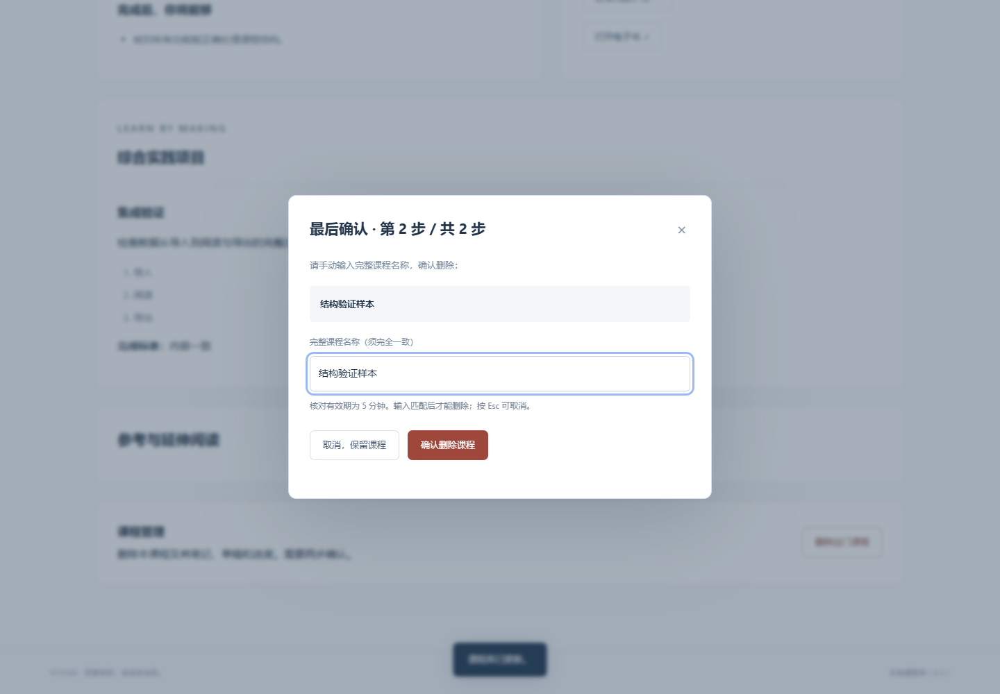

# Kotoba 学习室 · 0.2.1

在 Codex 聊天里明确学习目标，完整生成一门课，再回到本地程序阅读、练习与做笔记。首页是课程列表，目录、路线图、学习计划、课件和电子书都放在各自课程内部。

## 启动

需要 Node.js 24 或更新版本。运行时没有第三方依赖，不需要 npm install 或构建。

Windows 双击 `启动学习室.cmd`，或使用桌面上的“**Kotoba 学习室**”快捷方式。双击 `创建桌面快捷方式.cmd` 可在当前电脑重新创建入口；移动项目目录后需要重新创建。

其他平台或终端启动：

    npm start

访问 [本地课程库](http://127.0.0.1:4173)。只有本机可以访问，关闭网页时自动保存，后台服务可继续运行。Windows 双击 `停止学习室.cmd` 可停止后台；以 npm start 运行时按 Ctrl+C 停止。

全新克隆首次启动是空课程库。升级时保留原课程、笔记和已读进度，旧答题明细和复习历史移除；迁入的旧课会标记为“旧版课程”。

## 通过 Codex 创建完整课程

将这个项目文件夹作为 Codex 工作区，直接在聊天中发送：

> 我要学习日语。请按 COURSE_AUTHORING.md 逐个提问了解我的目标、基础和时间，再一次生成完整课程、详细课件、学习计划、大纲路线图和电子书，发布到课程库。

Codex 根据 `AGENTS.md` 读取 [课程编写流程](COURSE_AUTHORING.md)，每次只问一个问题。需求明确后连续完成全部章节，检查通过后一次发布；不会把空目录当作生成完成，也不要求用户每生成几章再说“继续”。列表会自动显示新增课程。

生成使用你正在使用的 Codex 聊天与账号。程序本身不包含 Codex 登录、付费 API 调用或应用内问卷。新聊天仍需要选择此项目工作区，其他人复制项目后使用自己的 Codex。

课程数量与科目不限定为日语；此前第一版的 12 章短课程限制已移除。数据格式保留合理的文件大小和结构上限，防止无效导入。

## 在课程中学习

- **课程概览**：目标、基础、时间预算、学习成果、综合项目和来源。
- **目录与课件**：详细知识讲解、例子、注音、自测解析、实践与笔记。
- **大纲路线图**：可点击的章节依赖图，以及每个前置关系的解释。
- **学习计划**：覆盖全课的周计划或阶段计划、每日安排。
- **电子书**：全部教材、计划、路线图和练习解析，支持完整 HTML 下载，离线打开或浏览器打印成 PDF。

笔记、当前实践草稿和阅读位置会自动保存；关闭页面时也会补充保存。临时断开服务时，待写入草稿先留在此浏览器中，恢复连接后继续写入。更换浏览器前先确保状态显示已自动保存，并导出课程库备份。

理解自测提供即时解析，不保存逐次答题历史。已读进度和笔记保留，不设置独立的学习记录页面。

在课程概览底部的“课程管理”可以删除课程。第一步核对课程、章节数和删除范围，第二步输入完全一致的课程名称，随后才能点击“确认删除课程”。取消或按 Esc 会保留课程。确认有效期为 5 分钟，服务端同时检查确认凭据、课程名称和课程内容，防止过期确认、重复提交或误删已改变的课程。

删除会移除当前课程库中的课程、笔记、实践草稿、阅读位置和已读进度，不能在程序中撤销。可先导出课程或整个课程库备份。已导出的文件和此前备份不会自动删除；从旧备份恢复可能重新带回已删除的课程。

电子书目前为 HTML，不是 EPUB；课件指程序中的详细教学正文，不默认生成 PPT。无真实录音或专业发音评分；旧课程引用的系统朗读按钮属于第一版功能，新版专注课程阅读框架。

## 给开发者和课程作者

    node scripts/course.mjs brief "日语"
    node scripts/course.mjs validate "data/drafts/my-course.json"
    node scripts/course.mjs publish "data/drafts/my-course.json"
    node scripts/course.mjs list
    npm test

完整格式、访谈流程、教学质量检查见 [COURSE_AUTHORING.md](COURSE_AUTHORING.md)。发布前检查章节正文、练习答案、计划覆盖和依赖关系，通过后一次加入课程库，并生成 `data/courses/<id>/course.json` 与 `book.html`。这些结构检查不等于教学内容已经得到人工认证。

主要文件：

| 文件 | 用途 |
| --- | --- |
| AGENTS.md、COURSE_AUTHORING.md | Codex 访谈、完整课程编写与发布约定 |
| scripts/course.mjs | 完整课程验证、发布和电子书生成 |
| src/domain.mjs、store.mjs | 课程结构、自动保存与数据库迁移 |
| src/server.mjs | 本地 HTTP 服务及导入导出 |
| src/book.mjs | 安全正文渲染、路线图与离线电子书 |
| public/ | 课程库与阅读界面 |
| test/ | 自动化测试及明确标记的测试数据 |

设置 `PORT` 可更换端口，设置 `KOTOBA_DATA_DIR` 可分离数据库。默认 SQLite 数据位于 `data/kotoba.sqlite`。通过“数据备份”导出或恢复整个课程库，通过首页导入单门完整课程 JSON。恢复备份前会保存本机快照；旧版备份恢复时也会移除旧答题明细。

共享版本只包含程序框架、图标、编写流程和自动化测试，不附带课程。test/ 中只有合成的结构测试输入，不是教学教材，也不会自动加入课程库。运行时不带账号、API 密钥、遥测或预置数据库；Codex 使用各自的账号。

Windows 可运行以下命令生成仅含框架的 ZIP（不必启动程序）：

    powershell -NoProfile -ExecutionPolicy Bypass -File scripts/package.ps1

打包采用明确文件白名单，不读取 data/、本机设置、工作区历史或 Git 元数据。输出位于 dist/，附有文件哈希清单。隐私范围与共享注意事项见 [隐私说明](docs/privacy.md)。

实际验证平台为 Windows + Edge。自动化结果及适用边界见 [验证记录](docs/verification.md)。项目使用 MIT 许可证。
